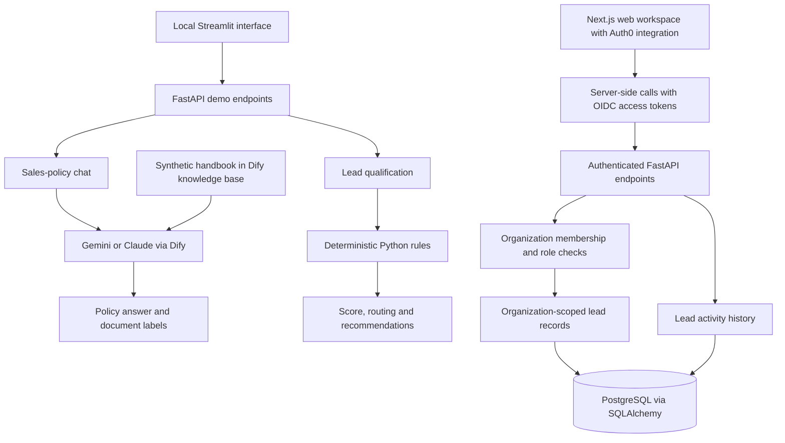

# AllSales CRM

**Sales-policy assistance, deterministic lead qualification, and organization-scoped lead management.**

AllSales CRM explores how a sales team could retrieve answers from approved policy documents, assess leads consistently, and manage organization-scoped lead records. It combines AI-assisted policy answers with deterministic Python decision rules so the language model does not determine sales scores or authorize actions.

> **Project status: local development prototype.** This repository uses a fictional company, a synthetic policy handbook and sample leads. The code is publicly available, but the application is **not** a deployed service, a complete CRM, or approved for real customer data.

## Public website

The [AllSales CRM public website](site/) is a static product showcase built from this repository's documented capabilities and actual synthetic-data screenshots. It does **not** host the FastAPI backend, customer login, AI providers, or a live CRM service.

GitHub Pages publishing is configured in `.github/workflows/site.yml`. The repository owner must select **Settings → Pages → Build and deployment → GitHub Actions**, confirm the deployment succeeds, and verify the published address before sharing it. See [website setup and verification](site/README.md).

## At a glance

| Capability | Implemented | Boundary |
| --- | --- | --- |
| Sales-policy Q&A | Gemini and Claude through separate Dify Chatflows | Requires externally configured Dify knowledge and API keys |
| Lead qualification | Deterministic scoring, priority, team routing, follow-up and escalation | Local Streamlit demo; recommendations only |
| AI explanations | Optional model-generated explanation of derived lead decisions | Advisory; does not override Python scoring |
| Account identity | OIDC token verification and organization memberships | Next.js/Auth0 login code exists; live sign-in is not yet verified |
| Lead record API | Organization-scoped create, list, read and update; role checks and activity history | Next.js pages use this API; real identity-provider login is not yet tested |
| Quality checks | Python and PostgreSQL tests, Playwright unauthenticated browser checks, CodeQL analysis, model evaluation and synthetic UI records | Live Auth0 sign-in and a complete customer workflow are not yet verified |

## How it works

AllSales CRM currently has **two development paths**. The newer web frontend and the original demo remain separate:



The Streamlit demo uses a **shared local development token**. The separate Next.js workspace has Auth0 session code; its FastAPI account and lead routes verify OIDC tokens and organization memberships. The full browser login and database journey **has not been tested with a live identity provider**. The authenticated workspace does not yet include the Dify policy assistant. Dify supplies document labels, not verified passage-level citations.

### Lead qualification example

A fictional EU SaaS company with 120 employees, a purchase decision expected within 20 days, final budget authority and no recorded engagement receives:

- **Score:** 85/100 — Priority A
- **Routing:** SMB Sales Team
- **Recommended first contact:** Within one business day

Missing mandatory fields prevent a final priority tier. Discount approvals and security incidents generate human-review or escalation recommendations; the application does not grant approval or contact customers.

### Local interface preview


*Screenshot from a synthetic local demonstration. The interface does not perform real CRM updates.*

See [lead qualification details](docs/LEAD_QUALIFICATION.md) and [local scenario evidence](docs/LOCAL_VALIDATION.md).

## Lead activity history

Authenticated lead creation and meaningful updates now generate organization-scoped activity records containing verified actor identity, changed field names and relevant status transitions. Organization owners and admins can view these events through a read-only API. The activity record and lead change share one transaction, helping prevent a successful change without its accompanying audit entry.

This is **development-grade activity tracking**, not immutable or production-compliant audit logging. See the [lead activity guide](docs/LEAD_ACTIVITY.md).

## Development account onboarding and database checks

A local-only administrator command can now create a **fictional test organization** and assign its first owner from a provider-issued development identity. It refuses remote databases, avoids reassigning existing organizations, and never changes existing membership roles.

A separate CI workflow runs **real PostgreSQL migrations and cross-organization API checks** against an ephemeral service. These complement the SQLite unit tests but do not prove commercial readiness or replace a live Auth0 browser login test.

Follow [local development onboarding](docs/LOCAL_ONBOARDING.md) to configure and verify these features. Do not use real customer data or bypass local-only safeguards.

## Customer web workspace

A new **Next.js + Auth0 customer workspace** is under development. It provides a landing page, hosted sign-in, an organizations list and organization-scoped synthetic lead screens, with server-side calls to the authenticated FastAPI endpoints. It is **not yet connected to a live Auth0 tenant or validated end-to-end**; real customer data and public deployment remain prohibited. Read the [customer web setup guide](docs/CUSTOMER_WEB.md).

## Run the local demo

The instructions below target **Windows PowerShell** and a local Python installation. They do not deploy a public service. Set `ALLSALES_ENV=local` explicitly in your untracked `.env`; the application refuses to start if the mode is missing or nonlocal.

**Requirements:** Python 3.11 or 3.12. Policy Q&A also needs a Dify workspace with the model providers configured, the included synthetic handbook indexed, and both sanitized Chatflows imported and re-linked. Follow the [Dify setup guide](docs/DIFY_REPRODUCTION.md).

From the repository root:

```powershell
py -m venv .venv
.\.venv\Scripts\python.exe -m pip install -r requirements-dev.txt
Copy-Item .env.example .env
.\.venv\Scripts\python.exe -c "import secrets; print(secrets.token_urlsafe(32))"
notepad .env
```

In `.env`, replace the placeholder `API_APP_TOKEN` with the newly generated token. For policy Q&A, add the **Dify application keys** to `DIFY_GEMINI_API_KEY` and `DIFY_CLAUDE_API_KEY`. Keep provider credentials in Dify itself. Never commit `.env`.

Verify the offline test suite:

```powershell
.\.venv\Scripts\python.exe -m pytest -q
```

Open two terminals in the repository root:

| Terminal 1 — FastAPI | Terminal 2 — Streamlit |
| --- | --- |
| `.\.venv\Scripts\python.exe -m uvicorn backend.api:app --host 127.0.0.1 --port 8000` | `.\.venv\Scripts\python.exe -m streamlit run app.py` |

Open **http://127.0.0.1:8501**. Choose **Policy assistant** for Dify-backed Q&A, or **Lead qualification** for the local rules-based example.

A Docker Compose setup is also available for local development: [container guide](docs/CONTAINERS.md). **The Docker workflow has not been independently verified on a clean machine.** Its exposed ports are loopback-only by design.

### Database and authenticated lead API

The organization-scoped lead API is **separate from the Streamlit demo**. It requires:

1. A development database configured with `DATABASE_URL` and Alembic migrations applied.
2. An explicitly configured OIDC issuer, API audience and HTTPS JWKS URL.
3. Provider-issued RS256 access tokens and provisioned organization memberships.

The API offers organization listing plus lead list/create/read/update endpoints, with role checks and organization-scoped queries. It does **not** offer public self-registration or invitation management; the Next.js login interface exists in code but has not been verified with a real Auth0 tenant. See [identity/database setup](docs/IDENTITY_AND_DATABASE.md) and [lead API reference](docs/LEAD_STORAGE.md).

## Testing and evidence

| Evidence | What it supports |
| --- | --- |
| Python tests and GitHub Actions | Offline checks on Python 3.11 and 3.12; includes rule boundaries, OIDC checks and organization-isolation cases |
| Dual-model evaluation | 17 curated handbook questions per model; all 34 stored final answers had correct essential policy facts in manual review |
| Completeness review | Gemini supplied all expected details in 14/17 answers; Claude in 17/17, with noted section-reference errors |
| Local UI scenarios | Five documented synthetic scenarios, including missing input, discount review, escalation and optional explanation |
| Sanitized Dify exports | Inspectable workflow definitions; the knowledge index and a new-workspace live reproduction remain unverified |

The evaluation uses a small, curated set and includes successful responses saved **after retries**. It is not evidence of first-attempt model reliability or general accuracy. The current automated test count should be taken from the latest CI run rather than the historical baseline.

Read the [evaluation report](docs/EVALUATION_RESULTS.md), [reviewed responses](data/evaluation_34_reviewed.csv) and [Dify workflow review](docs/DIFY_WORKFLOW_REVIEW.md).

## Repository structure

| Path | Purpose |
| --- | --- |
| `app.py` and `allsales/lead_ui.py` | Local Streamlit policy assistant and qualification interface |
| `backend/api.py` and `backend/lead_routes.py` | Demo endpoints and separate authenticated lead APIs |
| `allsales/` | Dify client, scoring, identity verification, database models and helpers |
| `migrations/` | Alembic database schema migrations |
| `knowledge/` and `dify_exports/` | Synthetic handbook and sanitized Gemini/Claude workflows |
| `data/`, `scripts/` and `tests/` | Evaluation records, reproducible scripts and automated tests |
| `docs/` | Architecture, setup, verification evidence and planned work |
| `Dockerfile` and `compose.yaml` | Local-only container setup |

## Roadmap to a usable product

The intended first commercial milestone is a **controlled pilot for one consenting business**, followed by broader rollout only after the required security and operational checks. The [working roadmap](docs/PRODUCTION_PLAN.md) is organized around hands-on VS Code implementation and tested user journeys; the [architecture reference](docs/COMMERCIAL_ARCHITECTURE.md) distinguishes existing components from planned technologies.

- **Identity and onboarding:** Real browser login, token lifecycle, organization invitations and provisioning.
- **Secure company workspaces:** Extend authorization to the entire application and knowledge retrieval; add database-level isolation and audit trails.
- **Operational workflows:** Approved CRM integrations, human authorization before writes, error handling and recovery.
- **Reliable AI:** Passage-level citations, expanded evaluation, provider cost tracking and failure monitoring.
- **Deployment and compliance:** Managed infrastructure, HTTPS, secret management, data retention/deletion, backups, load testing and security review.

The existing local-only startup restriction must stay in place until the complete security and deployment gates have been met.

See the [commercial architecture plan](docs/COMMERCIAL_ARCHITECTURE.md), [production development plan](docs/PRODUCTION_PLAN.md), and [security policy](SECURITY.md).

---

**Important:** This is a software development project using fictional data. No real CRM integration, customer-data processing, automatic discount approval or public SaaS availability is claimed.
