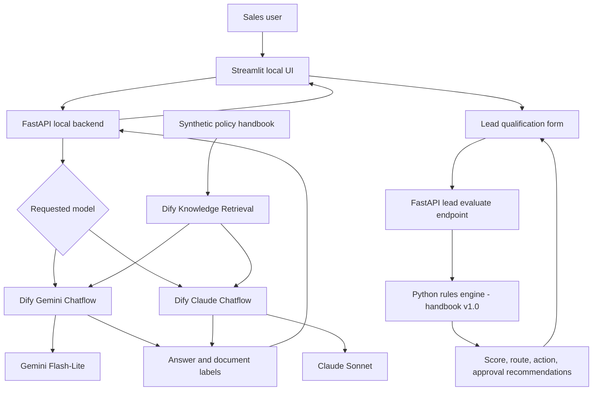

# AllSales CRM AI — Dual-Model RAG + Intelligent Lead Decisions

**Local development prototype — not a production CRM service.**  
All company data and rules in this repository are **synthetic**. The app answers fictional sales-policy questions and now evaluates **synthetic lead records** with deterministic scoring, routing, follow-up and approval rules. It does not access or change a real CRM.

## Evidence and current status

- Working policy assistant path, verified manually: **Streamlit → FastAPI → two Dify Chatflows → Gemini Flash-Lite / Claude Sonnet 5.5**.
- **Local browser verification:** normal 85-point qualification, missing employee count, 15% discount requiring written approval, security-first escalation, and successful optional Claude explanation. The explanation is advisory, not independently verified; see [validation record](docs/LOCAL_VALIDATION.md).
- Offline suite: **66 tests passed** in the tested source package (no LLM requests).
- Dual-model evaluation: **17 curated questions × 2 models**; 34 successful final answers after retries. Manual review: all **34 core answers correct**, but Gemini omitted expected detail in **3 of 17** answers and several answers misidentified handbook section numbers. See [evaluation report](docs/EVALUATION_RESULTS.md) and [reviewed dataset](data/evaluation_34_reviewed.csv).
- Opt-in model fallback for recognized transient errors is covered by unit tests; a real failure-triggered live fallback has **not** been demonstrated.
- Both sanitized Dify Chatflow packages are included in [`dify_exports/`](dify_exports/), with documented model/prompt/retrieval settings. A new workspace must **rebuild and re-link the external knowledge base**; a fresh-workspace import/live run has not been independently verified. See [Dify reproduction guide](docs/DIFY_REPRODUCTION.md).
- **Not production-ready:** shared local token is not user login, and there is no RBAC, tenant isolation, rate limiting, approved CRM integration, or operational monitoring.

## Lead qualification workflow

Use **Workspace → Lead qualification** in Streamlit. Enter a synthetic CRM lead, then select **Evaluate fictional lead**. A new FastAPI endpoint (`POST /v1/leads/evaluate`) applies the original handbook rules **without an LLM call** and returns a transparent score breakdown, priority only when qualified, proposed sales-team routing, follow-up targets, discount/consent safeguards, and security escalation instructions. No CRM records are saved or updated.

The optional **Gemini/Claude policy explanation** is a separate, explicitly requested model call. It sends only derived policy facts (not company/contact names or email), cannot override the score, and can consume model credits. See the [lead qualification guide](docs/LEAD_QUALIFICATION.md).

### Example lead decision

An EU SaaS company with 120 employees, decision within 20 days, final budget authority, no recorded engagement, and a complete synthetic CRM record scores **85/100 → Priority A → SMB Sales Team → first personalized contact within one business day**. Incomplete fields must be resolved before a priority tier is assigned.

## Architecture (current version)



The diagram above reflects the current local code. Dify retains the RAG workflow and shared knowledge-base configuration outside this repository. `source_documents` identifies **document labels**, not verified passage-level citations.

## Reproduce on Windows (PowerShell)

Prerequisites: Python 3.11+, a Dify workspace, Gemini and Anthropic model-provider credentials configured inside Dify, and the shared synthetic handbook indexed in a new Dify knowledge base. **Import the two included sanitized `.ifpkg` workflows and rebind that knowledge base** as described in the [Dify reproduction guide](docs/DIFY_REPRODUCTION.md).

From **the folder that contains `app.py`**:

```powershell
py -m venv .venv
.\.venv\Scripts\python.exe -m pip install -r requirements-dev.txt
Copy-Item .env.example .env
.\.venv\Scripts\python.exe -c "import secrets; print(secrets.token_urlsafe(32))"
notepad .env
```

Set the generated token as `API_APP_TOKEN` (replace the placeholder), insert the two **Dify app keys** in `DIFY_GEMINI_API_KEY` and `DIFY_CLAUDE_API_KEY`, then save `.env`. Never commit it. Keep the model-provider keys inside Dify settings, not in this repo.

```powershell
.\.venv\Scripts\python.exe -m pytest -q
```

In terminal 1 (leave running):

```powershell
.\.venv\Scripts\python.exe -m uvicorn backend.api:app --host 127.0.0.1 --port 8000
```

In terminal 2 (leave running):

```powershell
.\.venv\Scripts\python.exe -m streamlit run app.py
```

Open `http://localhost:8501`; select **Policy assistant** to chat with Gemini or Claude, or **Lead qualification** to evaluate a fictional sales lead with no LLM charges. The API documentation is visible locally at `http://127.0.0.1:8000/docs` and a process-only health check is `/health`. **Do not expose either service to the public Internet.**

## Evaluation without unnecessary costs

Offline preview (no API calls):

```powershell
.\.venv\Scripts\python.exe -m scripts.compare_models --limit 3
```

When deliberately running new live tests, prefer controlled batches and `--resume` to preserve successful results; live calls can consume model credits:

```powershell
.\.venv\Scripts\python.exe -m scripts.compare_models --live --resume --limit 17 --max-new-calls 1
```

`--resume` requires an existing local `results/dual_model_answers.csv` and **does not auto-grade correctness**. See [evaluation methodology](docs/EVALUATION.md). A public reviewed snapshot is provided in `data/evaluation_34_reviewed.csv`, while working results in `results/` are intentionally gitignored.

## Scope and safeguards

- **No real personal/customer records.** The handbook is fictional training material.
- A single shared development API token is **not production authentication**. No public deployment or claims of multi-tenant security.
- Model fallback is **off by default** and must be explicitly opted into; fallback creates a separate Dify conversation and the UI labels it.
- Dify credentials and handbook indexing remain external to Git. Both workflows and their retrieval settings are documented, but imported packages require re-linking the synthetic knowledge base and cannot guarantee identical results without matching indexing/model versions.
- For true production requirements, see [production plan](docs/PRODUCTION_PLAN.md).

## Repository guide

- `app.py` — Streamlit local UI with two workspaces
- `backend/api.py` — FastAPI interface, validation, model selection and new lead decision endpoint
- `allsales/dify_client.py` — Dify HTTP client and error handling
- `allsales/lead_qualification.py` — deterministic lead scoring, qualification, routing and escalation
- `allsales/lead_ui.py` — lead form, report and optional AI explanation
- `allsales/lead_explanation.py` — minimum-data policy explanation prompt
- `knowledge/` — synthetic sales-policy handbook
- `data/golden_17_questions.csv` — evaluation questions with expected policy facts
- `data/evaluation_34_reviewed.csv` — manually reviewed model outputs (no real customers)
- `scripts/` — offline lead demo, evaluation utilities and controlled live collectors
- `tests/` — 66 offline tests (including lead-rule boundaries, missing fields, auth and fallback)
- `dify_exports/` — Gemini and Claude sanitized Dify app packages (workspace dataset ID removed)
- `docs/` — setup, validation evidence, model review and engineering guidance

## Development and commercial direction

The application is **local-only**. It cannot be operated as a public customer-facing service in its current form. Runtime startup rejects nonlocal `ALLSALES_ENV` modes as a safety measure, not as a substitute for production security.

- [Run both services with Docker Compose on your own computer](docs/CONTAINERS.md)
- [Commercial architecture, priorities, and acceptance criteria](docs/COMMERCIAL_ARCHITECTURE.md)
- [Security scope and reporting](SECURITY.md)

Do not put real customers' personal information into this prototype. Each commercially deployable capability will need its own tested implementation, review, and Git commit.

## Project status and documentation

This project is a local educational prototype based on fictional sales policies and leads. It does not connect to a real CRM, and the shared development token is not a production user authentication system.

- [Project status and limitations](docs/PROJECT_STATUS.md)
- [Lead qualification](docs/LEAD_QUALIFICATION.md)
- [Local validation](docs/LOCAL_VALIDATION.md)
- [Evaluation results](docs/EVALUATION_RESULTS.md)
- [Dify workflow review](docs/DIFY_WORKFLOW_REVIEW.md) and [setup](docs/DIFY_REPRODUCTION.md)
- [Reliability and fallback](docs/RELIABILITY.md)
- [Production development plan](docs/PRODUCTION_PLAN.md)
