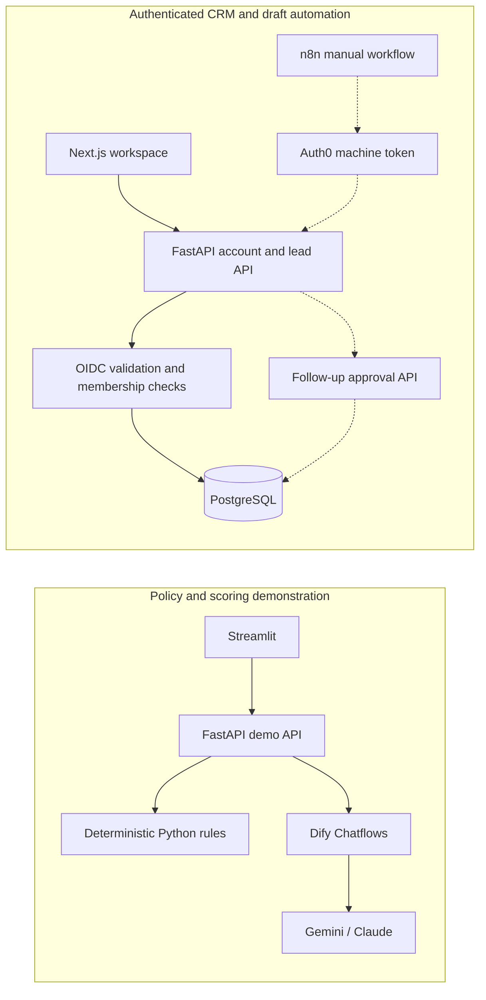
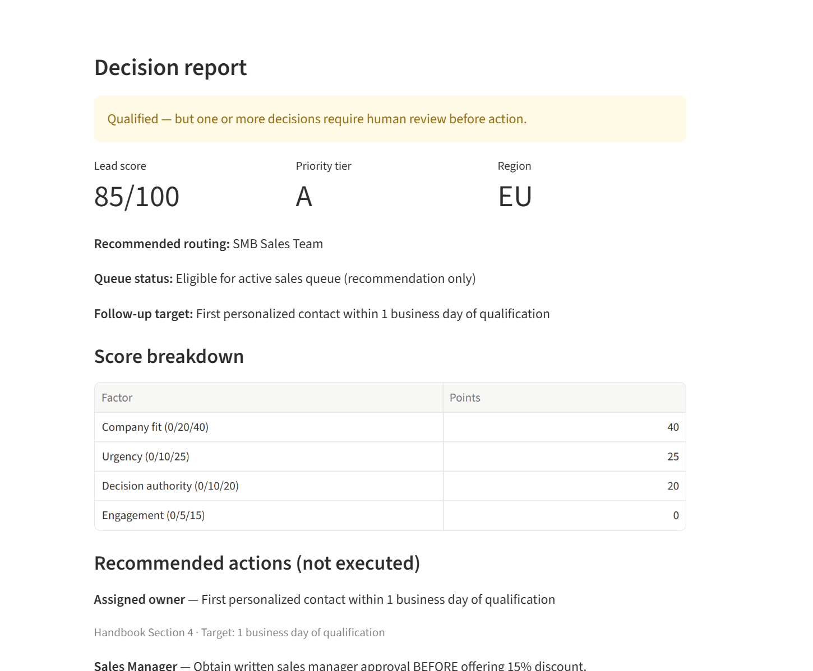

# AllSales CRM

**AI-assisted sales policy intelligence · Deterministic lead qualification · Organization-scoped CRM · Human-approved automation**

AllSales CRM is a local-development software project exploring how B2B sales teams can retrieve policy information, qualify leads consistently, manage a shared pipeline, and request follow-up actions without giving an AI model or automation service unrestricted authority.

> **Development status — November 28, 2026:** Synthetic-data prototype, not a deployed SaaS or a production CRM. The authenticated CRM foundation is on `main`; the locally demonstrated, machine-to-machine follow-up approval workflow is under review in [draft PR #32](https://github.com/FerhatU9/AllSalesCRM-AI/pull/32). The draft feature now includes a separately authorized, retry-safe database-only execution simulation. No external outreach is enabled.

## Start here

| Resource | Description |
| --- | --- |
| [**Technical engineering report (PDF)**](docs/AllSales_CRM_Technical_Report.pdf) | Nine-page architecture and release-readiness report (approval-stage snapshot at 1409a49) |
| [Follow-up automation guide](docs/FOLLOWUP_AUTOMATION.md) | Reproduce the locally demonstrated Auth0 → n8n → CRM workflow on the feature branch |
| [Importable n8n workflow](n8n-workflows/sales_followup_automation.json) | Credential-free manual demo template; locally reproduced through approved execution |
| [LangGraph lead recommendations](docs/LEAD_RECOMMENDATIONS.md) | Read-only, status-driven review guidance (validated local-rules panel) |
| [Structured qualification preview](docs/QUALIFICATION_PREVIEW.md) | Draft: deterministic score with opt-in Gemini/Claude policy explanation |
| [Project status and limitations](docs/PROJECT_STATUS.md) | Demonstrated behavior, automated checks and open gates |
| [Product roadmap](docs/PRODUCTION_PLAN.md) | Hands-on implementation milestones toward a controlled pilot |
| [Public website source](site/) | Static product showcase; it does not run the CRM backend or provide live customer access |

## Capabilities

| Capability | Development evidence | Boundary |
| --- | --- | --- |
| Sales-policy Q&A | Gemini and Claude through separate Dify Chatflows | Synthetic policy knowledge; external Dify configuration required |
| Lead qualification | Deterministic Python scoring, priority, team routing and recommendations | Model explanations cannot override scores or approve actions |
| Authenticated workspace | Next.js, live development Auth0 login/logout, synthetic leads | Not self-service customer onboarding |
| Lead API and storage | FastAPI membership checks, PostgreSQL, SQLAlchemy, Alembic and lead activity history | Application-level tenant isolation; additional database and security controls required |
| Human-approved follow-ups | Draft feature: pending requests, idempotent creation, owner/admin decisions, authorized execution simulation | Approval alone cannot execute |
| n8n integration | Draft feature: restricted Auth0 machine token, lead filtering, request creation, status verification, internal execution | Local manual workflow, synthetic data only |
| LangGraph recommendations | Draft feature: authorized read-only graph, conditional routing and review checklist in the CRM | No inferred scoring, model calls or mutations |
| Structured qualification preview | Draft feature: synthetic facts, deterministic score, conditional optional Dify explanation | No persistence, no CRM mutation; provider use is explicit and advisory |
| Quality engineering | Python, TypeScript, Chromium smoke tests, PostgreSQL integration, CodeQL | Not an independent security assessment |

## Architecture

There are two deliberately separate local development paths.



Solid connections represent the CRM foundation; dotted connections represent the draft follow-up integration. The legacy Streamlit demo uses a shared local development token. The authenticated workspace uses provider-issued access tokens; all authorization decisions are made in FastAPI, not the browser or n8n. The draft CRM includes a separate qualification preview with an optional Dify explanation of derived policy facts. Organization-specific retrieval is not implemented.

See [architecture and commercial requirements](docs/COMMERCIAL_ARCHITECTURE.md) and the [security policy](SECURITY.md).

## Sales intelligence

A fictional EU SaaS company with 120 employees, a purchase decision expected within 20 days, final budget authority and no recorded engagement receives **85/100 — Priority A**, routing to the SMB Sales Team and recommended first contact within one business day. Missing mandatory fields prevent a final tier; discount and security exceptions require human review.



*Actual synthetic-data Streamlit demonstration. This interface does not perform CRM writes or send messages.*

Read the [lead qualification specification](docs/LEAD_QUALIFICATION.md) and [local scenario evidence](docs/LOCAL_VALIDATION.md).

## Human-in-the-loop CRM automation (draft PR)

The verified local workflow uses a dedicated machine identity with the `request:followups` and `execute:followups` permissions and an `automation` membership in the fictional demo organization. The service retrieves permitted leads, requests a follow-up for the qualified demo lead, and reads the stored decision after a human owner approves it in the CRM. The same machine identity can execute its own approved, unexpired request through the backend.

```text
Manual Trigger → Demo Configuration → Check API Health → List Assigned Organizations
 → List Demo Leads → Filter Qualified Leads → Request Sales Follow-up
 → Check Follow-up Status → Verify Approved Request → Execute Approved Follow-up
```

The local n8n workflow retained one matching approved request and successfully transitioned its status to `executed`. A separate attempt to approve using the machine identity returned HTTP 403. Execution changes the follow-up database record only; no email, notification or customer outreach occurs. The sanitized ten-node template was imported into a separate local workflow, reconnected to the dedicated OAuth2 credential, and reproduced through pending creation, human approval and execution. See the [workflow import and verification guide](docs/FOLLOWUP_AUTOMATION.md) and [feature branch](https://github.com/FerhatU9/AllSalesCRM-AI/tree/feature/followup-approval).

## LangGraph lead recommendations (draft feature)

The first LangGraph workflow reads two derived facts from an authorized lead: its stored status and whether it has a summary. Conditional routing produces review or hold guidance; the follow-up page displays it without creating or executing a request. This is local rule orchestration, not LLM-generated advice. See the [implementation and local validation guide](docs/LEAD_RECOMMENDATIONS.md). The developer demonstrated this panel and execution timestamps in the authenticated workspace. A separate [structured qualification preview](docs/QUALIFICATION_PREVIEW.md) evaluates explicitly supplied fictional inputs and optionally explains the deterministic score via Gemini or Claude. The local authenticated form and both Dify connections have been demonstrated; both models initially abstained after configuration. The revised retrieval-oriented query still needs live grounded-answer verification.

## Run locally

**Requirements:** Python 3.11/3.12; Node.js 20.9+ for the web workspace; Docker and a development PostgreSQL database for CRM and n8n. Use fictional data only. The following commands target Windows PowerShell.

### 1. Streamlit policy and scoring demo

From a fresh clone at the repository root:

```powershell
py -m venv .venv
.\.venv\Scripts\python.exe -m pip install -r requirements-dev.txt
Copy-Item .env.example .env
.\.venv\Scripts\python.exe -c "import secrets; print(secrets.token_urlsafe(32))"
notepad .env
```

Set `ALLSALES_ENV=local` and replace `API_APP_TOKEN` with the generated secret. For policy Q&A, configure `DIFY_GEMINI_API_KEY` and `DIFY_CLAUDE_API_KEY` after following the [Dify reproduction guide](docs/DIFY_REPRODUCTION.md). Do not overwrite an existing environment or commit secrets.

```powershell
.\.venv\Scripts\python.exe -m pytest -q
```

Open separate terminals:

| FastAPI | Streamlit |
| --- | --- |
| `.\.venv\Scripts\python.exe -m uvicorn backend.api:app --host 127.0.0.1 --port 8000` | `.\.venv\Scripts\python.exe -m streamlit run app.py` |

Open http://127.0.0.1:8501. See the [local container guide](docs/CONTAINERS.md) for the alternative Compose setup.

### 2. Authenticated CRM

Follow [local onboarding](docs/LOCAL_ONBOARDING.md), [identity/database configuration](docs/IDENTITY_AND_DATABASE.md) and [customer web setup](docs/CUSTOMER_WEB.md). The observed CRM development ports were web **3000**, FastAPI **8001**, and PostgreSQL **5434**. Configure exact issuer, audience, JWKS URL and local database connection. Run Alembic migrations and provision a fictional organization and verified human owner before logging in.

For the draft automation feature, use the [follow-up guide](docs/FOLLOWUP_AUTOMATION.md) and isolated [n8n setup](docs/N8N_SETUP.md) (host port 5679). Never reuse a web client secret as an automation credential.

## Validation and evaluation

**Validated feature snapshot:** [da5af67](https://github.com/FerhatU9/AllSalesCRM-AI/commit/da5af676d757e6500026c47b3f2042e8e1210e5b).

- All five PR workflows passed: Python tests, web workspace checks, browser smoke tests, PostgreSQL integration and CodeQL.
- Developer-observed full local Python regression: 122 passed, 1 skipped, 7 warnings, 21 subtests passed. Automated execution cases passed; a local n8n execution returned `executed`. Local PostgreSQL migration 005 applied successfully.
- Development Auth0 browser journey verified login/logout, membership, lead persistence and owner/viewer presentation. Owner approval/rejection and n8n machine approval denial were tested on the feature branch.
- The earlier 118-pass local baseline is historical. Check [current Actions runs](https://github.com/FerhatU9/AllSalesCRM-AI/actions) for the latest results. Browser smoke checks are not a full authenticated browser suite; PostgreSQL CI covers migrations and lead isolation, not all follow-up concurrency behavior.

| Curated evaluation metric | Gemini | Claude |
| --- | ---: | ---: |
| Correct essential facts, stored final answers | 17/17 | 17/17 |
| All expected details | 14/17 | 17/17 |
| Wrong numbered section references | 1 | 2 |
| Mean recorded latency | 8.84 s | 4.30 s |
| Reported tokens (sum) | 9,783 | 16,167 |

The 34 stored final responses were manually reviewed **after retries** on 17 curated synthetic handbook questions per model. These results do not establish first-attempt reliability, general accuracy or comparative cost. See the [evaluation report](docs/EVALUATION_RESULTS.md), [reviewed responses](data/evaluation_34_reviewed.csv) and [Dify workflow review](docs/DIFY_WORKFLOW_REVIEW.md).

## Repository map

| Path | Responsibility |
| --- | --- |
| `app.py`, `allsales/` | Streamlit interface, scoring rules, Dify adapters, identity verification and persistence |
| `backend/` | FastAPI demo and authenticated CRM endpoints |
| `web/` | Next.js / TypeScript workspace |
| `migrations/` | Alembic database schema history |
| `knowledge/`, `dify_exports/` | Synthetic sales handbook and sanitized Chatflows |
| `data/`, `scripts/`, `tests/` | Evaluation data, development commands and tests |
| `n8n-workflows/` | Sanitized manual follow-up workflow template |
| `docs/` | Engineering report, setup, architecture and evidence |
| `site/` | Static product showcase |
| `.github/workflows/` | CI and static site publishing configuration |

## Roadmap

1. Review the locally reproduced n8n import and the draft PR; capture direct live replay/timestamp evidence.
2. Extend execution authorization and PostgreSQL concurrency coverage; preserve the database-only simulation and never enable real outreach.
3. Improve multi-user CRM usability, authenticated browser coverage and organization administration.
4. Validate the new synthetic qualification preview and opt-in model explanation; then extend evidence-based retrieval and evaluate grounded answers.
5. Design secured Azure staging, monitoring, backup/restore, cost controls and security review.
6. Consider a consenting controlled pilot only after release gates are met.

See the [production plan](docs/PRODUCTION_PLAN.md). The local-only restriction remains in force; no real customer data, automatic outreach, public SaaS availability or production readiness is claimed.
