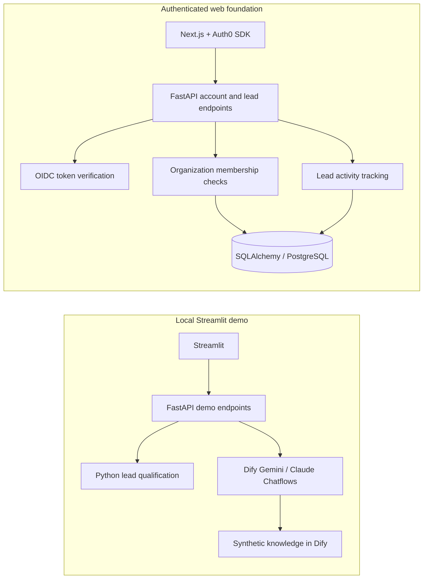

# AllSales CRM — Architecture and commercial requirements

AllSales CRM is a **local development prototype** intended to become an AI-assisted B2B sales product. The initial commercial target is a controlled pilot with one consenting business. See the [product development roadmap](PRODUCTION_PLAN.md) for the sequence, hands-on development approach and release gates.

## Implemented architecture

**Important distinctions:**

- The Streamlit demo uses a shared local development token. It is not a production login mechanism.
- The Next.js code includes Auth0 integration and passes frontend builds, but a **real Auth0 browser login has not been verified**.
- The FastAPI lead and account endpoints verify bearer tokens and check organization memberships. PostgreSQL integration is tested against a disposable CI database, not a production service.
- The authenticated Next.js workspace does **not** yet include the Dify policy assistant. The synthetic Dify knowledge is not organization-aware.
- Lead activity events exist, but no immutable/tamper-resistant operational audit service has been demonstrated.
- Docker Compose currently runs the local FastAPI/Streamlit demo, **not** a fully configured Next.js/Auth0/PostgreSQL product.

## Architecture decisions

| Concern | Existing work | Target and acceptance condition |
| --- | --- | --- |
| Browser experience | Next.js pages plus separate Streamlit demo | Complete authenticated workflow and tested permission-aware UI |
| API | FastAPI demo routes and authenticated account/lead routes | One consistently secured customer API; shared-token routes isolated from deployments |
| Identity | Auth0 SDK code and FastAPI RS256 token verification | Live OIDC login, lifecycle, invitations and role administration tested |
| Data | SQLAlchemy, Alembic, organization-scoped leads and activity records | Proper tenant isolation, migrations, recovery, retention and authorization |
| AI | Dify Chatflows for Gemini/Claude | Approved company-scoped retrieval, source-span citations, evaluation and abstention |
| Decision logic | Deterministic lead qualification | Versioned, approved rules independent from LLM-generated text |
| Workflow automation | No integrated live CRM workflow | Sandbox integration, authentication, explicit approvals, idempotent actions |
| Reliability | GitHub CI, disposable PostgreSQL integration, local Docker configuration | Browser tests, staging, observability, alerting, restore drills and security review |
| Deployment | Local-only startup restriction | Controlled hosting only after documented identity, data protection and operational gates |

## Product security boundaries

All input and data are currently synthetic. Do not enable public serving or use real customer information. Never treat the model, browser, tenant ID in a URL, or GitHub CI success as authorization. The backend must verify the identity and effective company membership on every sensitive operation, including retrieval.

The product still needs comprehensive company-level access enforcement, privacy practices, secure secrets management, monitoring, rate limits, backup restoration, incident procedures and an independent security assessment.

## Product-building practice

The developer implements and runs meaningful product steps in VS Code with clear guidance about **what**, **why** and **how**. Record observed behavior and tests before calling a feature complete. Repository maintenance can be handled separately; it does not replace learning how the actual technologies work.

Choose additional tools only when they solve demonstrated product needs. LangGraph, n8n, OpenTelemetry, Playwright and managed cloud services are possible future additions, not capabilities currently verified.

## Related documentation

- [Roadmap and completion gates](PRODUCTION_PLAN.md)
- [Implemented features and limitations](PROJECT_STATUS.md)
- [Customer web setup](CUSTOMER_WEB.md)
- [Database and development onboarding](LOCAL_ONBOARDING.md)
- [Security policy](../SECURITY.md)
