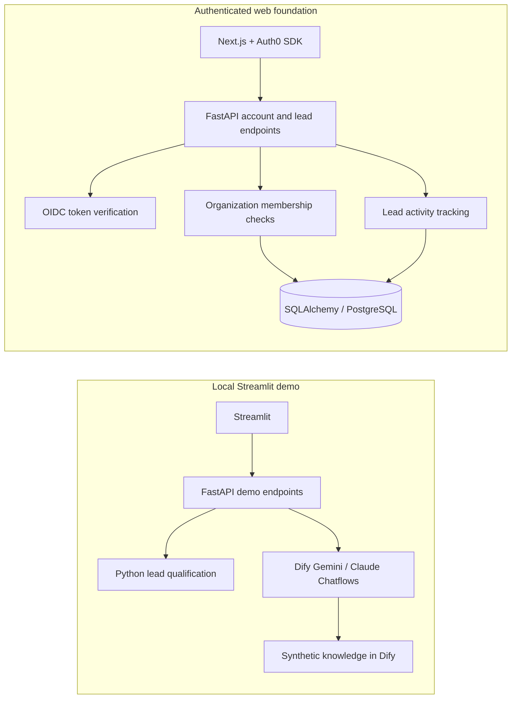

# AllSales CRM — Architecture and commercial requirements

AllSales CRM is a **local development prototype** intended to become an AI-assisted B2B sales product. The initial commercial target is a controlled pilot with one consenting business. See the [product development roadmap](PRODUCTION_PLAN.md) for the sequence, hands-on development approach and release gates.

## Implemented architecture

**Important distinctions:**

- The Streamlit demo uses a shared local development token. It is not a production login mechanism.
- The Next.js code includes Auth0 integration and passes frontend builds; a real development Auth0 browser login and synthetic lead journey have been demonstrated locally.
- The FastAPI lead and account endpoints verify bearer tokens and check organization memberships. Local PostgreSQL lead persistence was demonstrated across sessions; a separate disposable PostgreSQL CI workflow covers migration and isolation checks. Neither is a production service.
- The authenticated Next.js workspace does **not** yet include the Dify policy assistant. The synthetic Dify knowledge is not organization-aware.
- Lead activity events exist, but no immutable/tamper-resistant operational audit service has been demonstrated.
- Docker Compose currently runs the local FastAPI/Streamlit demo, **not** a fully configured Next.js/Auth0/PostgreSQL product.

## Draft follow-up automation extension

On the [feature branch](https://github.com/FerhatU9/AllSalesCRM-AI/tree/feature/followup-approval), n8n authenticates with its own Auth0 machine application. FastAPI checks signed token scope and the restricted organization membership. It reads permitted leads and creates pending requests. Owners/admins decide in the CRM; n8n reads the stored outcome. The automation identity cannot approve or update leads. The request lifecycle is persisted with migrations 004–005; the separately scoped execution endpoint records a retry-safe `executed` state for qualified, approved, unexpired requests owned by the machine requester. There is no external delivery. The feature is locally demonstrated and subject to draft PR review. See the [workflow guide](FOLLOWUP_AUTOMATION.md) and [technical report](AllSales_CRM_Technical_Report.pdf).

## Architecture decisions

| Concern | Existing work | Target and acceptance condition |
| --- | --- | --- |
| Browser experience | Next.js pages plus separate Streamlit demo | Complete authenticated workflow and tested permission-aware UI |
| API | FastAPI demo routes and authenticated account/lead routes | One consistently secured customer API; shared-token routes isolated from deployments |
| Identity | Auth0 SDK code and FastAPI RS256 token verification | Token lifecycle, invitations, role administration and production identity security review |
| Data | SQLAlchemy, Alembic, organization-scoped leads and activity records | Proper tenant isolation, migrations, recovery, retention and authorization |
| AI | Dify Chatflows for Gemini/Claude | Approved company-scoped retrieval, source-span citations, evaluation and abstention |
| Decision logic | Deterministic lead qualification | Versioned, approved rules independent from LLM-generated text |
| Workflow automation | Draft PR #32: restricted Auth0 machine identity, tenant-scoped follow-up requests, human decisions, authorized database-only execution and sanitized n8n template | Fresh-import verification, full PostgreSQL concurrency and security review; no external action |
| Reliability | GitHub CI, disposable PostgreSQL integration, local Docker configuration | Browser tests, staging, observability, alerting, restore drills and security review |
| Deployment | Local-only startup restriction | Evaluate Azure Container Apps, managed PostgreSQL, Key Vault and Azure Monitor for controlled staging after local gates |

## Product security boundaries

All input and data are currently synthetic. Do not enable public serving or use real customer information. Never treat the model, browser, tenant ID in a URL, or GitHub CI success as authorization. The backend must verify the identity and effective company membership on every sensitive operation, including retrieval.

The product still needs comprehensive company-level access enforcement, privacy practices, secure secrets management, monitoring, rate limits, backup restoration, incident procedures and an independent security assessment.

## Product-building practice

The developer implements and runs meaningful product steps in VS Code with clear guidance about **what**, **why** and **how**. Record observed behavior and tests before calling a feature complete. Repository maintenance can be handled separately; it does not replace learning how the actual technologies work.

The agreed sequence is: **verify the authenticated CRM foundation → add n8n follow-up automation with explicit approval → complete the sales workspace → introduce organization-scoped LangGraph AI workflows → stage the application on Azure → run a controlled pilot**. See [roadmap](PRODUCTION_PLAN.md) for concrete tests and release gates. This sequence does not mean these additional technologies are already implemented.

n8n is the first locally demonstrated integration after the real Auth0/PostgreSQL journey (draft feature); no scheduled or external outbound activity is enabled by default. LangGraph orchestrates justified multi-step AI logic; FastAPI retains the authorization boundary, and all external actions require recorded approval. Azure Container Apps and managed PostgreSQL are staging candidates only after local testing and cost approval. Kubernetes and complex distributed infrastructure remain deferred.

## Related documentation

- [Roadmap and completion gates](PRODUCTION_PLAN.md)
- [Implemented features and limitations](PROJECT_STATUS.md)
- [Customer web setup](CUSTOMER_WEB.md)
- [Database and development onboarding](LOCAL_ONBOARDING.md)
- [Security policy](../SECURITY.md)
