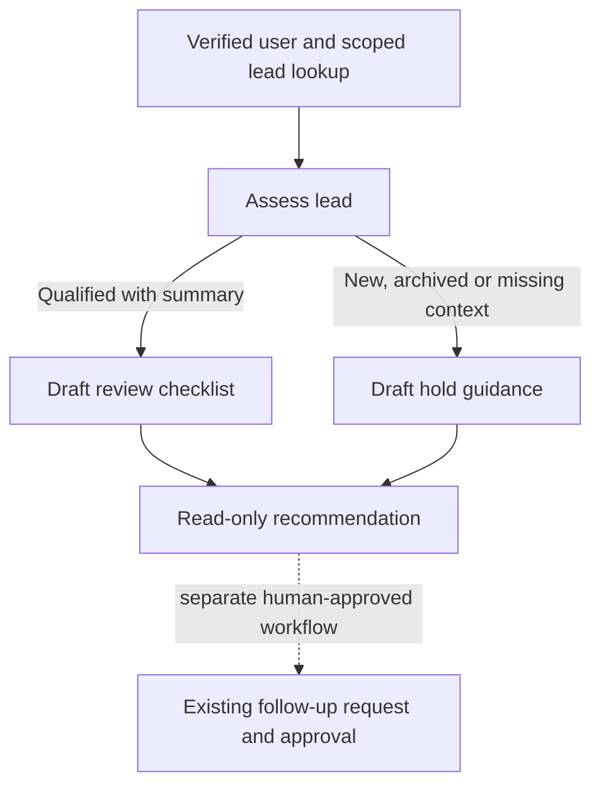

# Lead recommendations — LangGraph

**Development milestone:** a local, read-only recommendation workflow on the follow-up feature branch. It uses LangGraph's graph orchestration, but does not yet call Gemini, Claude or any external model. The separate [qualification preview](QUALIFICATION_PREVIEW.md) now reuses the existing deterministic engine and Dify adapters; this original panel remains purely local.

## Why add LangGraph?

A sales recommendation has several decision stages. A graph makes those stages and their routing explicit, so later AI drafting can be introduced without giving a model permission to change CRM records.



The dotted connection is a separate human decision, **not** a graph edge or an automatic request.

## How it works

| Component | Responsibility |
| --- | --- |
| [Authenticated API](../backend/lead_routes.py) | Validate bearer identity and organization membership, load the lead and reject machine callers |
| [Recommendation graph](../allsales/recommendation_graph.py) | Receive only the stored status and a Boolean indicating whether a summary is present |
| State and conditional edge | Choose whether to draft a review checklist or hold guidance |
| [Next.js server client](../web/lib/backend.ts) | Make authenticated API calls from the server; display the response in the follow-up page |
| [Tests](../tests/test_recommendation_graph.py) | Check routes, repeated invocation, authorization, data minimization and no database mutations |

The CRM record does not include all the structured fields required by the existing [qualification engine](../allsales/lead_qualification.py). Do not infer employee count, budget, contact consent, priority score or authority from free text.

| Stored lead status | Summary present? | Recommended action |
| --- | --- | --- |
| qualified | yes | Review a follow-up opportunity |
| qualified | no | Review missing context |
| new | either | Complete lead qualification |
| archived | either | No follow-up recommended |

Each result includes a reason and review checklist. It always has `human_review_required: true`, `automated_actions_taken: 0` and `mode: local_rules`. No raw summary, company name, contact identifier or token enters the graph; remote LangSmith tracing is disabled explicitly for the invocation. There is no model call, checkpoint store, request creation, approval, n8n trigger or external delivery.

## Reproduce locally (PowerShell)

On the feature branch, with the existing local virtual environment activated:

```powershell
git pull --ff-only origin feature/followup-approval
python -m pip install -r requirements-dev.txt
python -m pytest -q tests/test_recommendation_graph.py
python -m pytest -q
```

Restart the FastAPI service and Next.js development server if already running. From separate terminals:

```powershell
# Repository root
python -m uvicorn backend.api:app --host 127.0.0.1 --port 8001
```

```powershell
cd web
npm run dev
```

No new database migration or API key is required. Use the exact existing `APP_BASE_URL` (e.g. `http://127.0.0.1:3000`) and open the synthetic lead's Follow-ups page. The **Sales recommendation** panel should show the current status-driven guidance, and executed follow-up records should display their execution timestamp. The approval controls remain unchanged. If the recommendation endpoint is unavailable, the existing follow-up page remains usable.

API contract: `GET /v1/organizations/{organization_id}/leads/{lead_id}/recommendation`. It requires a verified human membership (owner/admin/sales/viewer), returns 404 across unauthorized organization boundaries and rejects automation callers with 403. The response is not authorization to act.

## Engineering verification

On the development checkout (Python 3.12), all eight new graph/API tests passed and the full suite passed: 130 tests, 1 skipped PostgreSQL-only test, 7 non-blocking warnings and 21 subtests. The Next.js TypeScript check and production build with synthetic configuration passed. Five GitHub Actions workflows passed at b1dcccc. The developer demonstrated the local authenticated owner panel with the expected qualified-lead checklist and execution timestamps on November 28. Real PostgreSQL concurrency coverage and live model-backed explanations remain outstanding.

## Next stage

The [structured qualification preview](QUALIFICATION_PREVIEW.md) implements fictional inputs and conditional opt-in explanation of derived policy facts. Validate the new form and real provider calls locally. Validate citations, missing-data abstention, prompt injection, cross-tenant isolation, privacy and cost before any live customer retrieval or external action. Retain the existing human approval and idempotent backend execution as the only action boundary.

See the [LangGraph Graph API documentation](https://docs.langchain.com/oss/python/langgraph/graph-api), [production plan](PRODUCTION_PLAN.md), and [follow-up automation guide](FOLLOWUP_AUTOMATION.md).
