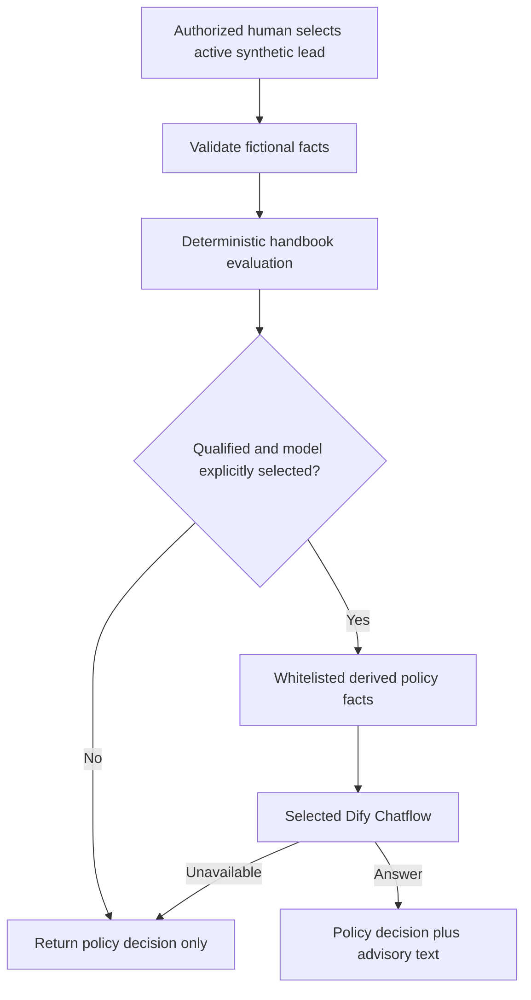

# Structured qualification preview — LangGraph + optional Dify

**Status (28 November 2026):** implementation and automated development checks passed on the draft follow-up branch. The existing read-only recommendation panel and the new deterministic preview were demonstrated in the local authenticated customer workspace; the fictional sample produced 85/100, Tier A and SMB Sales Team routing. Both provider selections initially returned unavailable because the app keys were not configured. After local configuration, live Gemini and Claude screens returned the published Chatflows' canonical no-evidence answer, demonstrating connectivity but not a grounded explanation. The deterministic decision remained intact. Successful grounded explanations remain unverified.

## Purpose and boundary

The original recommendation panel reads stored lead status and summary presence only. This separate preview runs the existing synthetic handbook scoring engine against explicitly supplied fictional structured facts. It does not save those facts, change the stored lead status, create a request, or execute a follow-up. The qualification outcome is not the approval state.

| Technology | Why it is used |
| --- | --- |
| Pydantic | Shared input constraints and typed response; missing or unverified information stays explicit |
| Python policy engine | Reproducible 0–100 scoring, classification, routing and mandatory review actions |
| LangGraph | Conditional evaluation flow with an explicit stop or optional explanation branch |
| Dify Gemini / Claude | Opt-in policy explanation; the selected app must already be configured |
| Auth0 / FastAPI / SQLAlchemy | Verified human identity, tenant-scoped lookup, role checks; no writes |
| Next.js | Server-side bearer-token handling, a synthetic facts form and separate rule/model results |



There is no graph persistence or remote tracing. The API releases its read transaction before a model call. The optional model cannot alter the score, select another model, perform CRM actions or provide authorization. Model text and provider-reported document names are unverified and rendered as plain text. They do not constitute passage-level citations.

## Reproduce the local journey

With your existing local backend, database, Auth0 settings, and the feature branch:

```powershell
git pull --ff-only origin feature/followup-approval
python -m pytest -q
```

Restart the FastAPI and Next.js services using the existing ports and configuration; no dependency or migration change is required after the earlier LangGraph milestone. Sign in at the configured frontend origin (the demonstrated setup uses `http://127.0.0.1:3000`).

1. Open the synthetic Nordvale Technologies lead's **Follow-ups** page.
2. Choose **Evaluate lead** under Sales recommendation.
3. Select **Load synthetic example**, confirm the fictional-data checkbox, keep **Local rules only**, and select **Preview qualification**. The stored company name and summary must be nonempty; the form supplies the remaining fictional inputs.
4. Expect 85/100, Tier A, EU, SMB Sales Team, eligible recommendation, and a one-business-day personalized-contact target. The stored status and follow-up history must not change.
5. Delete a required field or choose unknown engagement; submit again. The result must not assign a tier. Model explanation must be withheld when information is incomplete.
6. Reload the synthetic example, confirm again and choose Gemini or Claude only if the corresponding Dify Chatflow uses the synthetic handbook. Submit explicitly. The same score must remain authoritative. Check the advisory response and any document names against the handbook. If the provider is unavailable, the deterministic result remains visible.
7. Return to Follow-ups. Review history; no new request should be present and no status should have changed.

For step 6, configure the backend's existing ignored root `.env` with `DIFY_GEMINI_API_KEY` (legacy `DIFY_API_KEY` fallback) or `DIFY_CLAUDE_API_KEY`, and `DIFY_BASE_URL` if non-default. Keep keys in local configuration, not the browser or the repository. Do not use real customer information, and do not enable provider tools or external action integrations. An explicit model selection may incur model usage and latency; the existing client has 10-second connect and 90-second read timeouts. No automatic retries or provider fallback are performed by this preview.

## Diagnose unavailable AI explanations

The preview continues to work even if Dify is unavailable. Updated builds show a bounded failure reason in the AI explanation panel and log only the provider name and normalized reason code in FastAPI. Neither location displays raw upstream error text, secrets or lead facts.

| Reason | Check locally |
| --- | --- |
| Missing configuration | Root `.env`: matching published Chatflow app API key |
| Invalid configuration | Dify base URL (HTTPS, or exact local loopback) |
| Access rejected | Dify app API key, published app/API access |
| Rate limited | Dify/model quota and billing |
| Provider busy or request rejected | Dify Chatflow run history, model and retrieval configuration |
| Network or timeout | Connectivity; check existing run before retrying |
| Invalid response or empty answer | Published Chatflow API, retrieval and Answer nodes |

Restart FastAPI after changing configuration. Do not alter Auth0 permissions to resolve a Dify error. A model call may consume quota; only explicitly retry once the cause is understood. The deterministic score remains authoritative.

## Diagnose an abstained explanation

Both live model routes returned the handbook's explicit no-evidence response. The relevant rules **do** exist in the repository handbook: Sections 3–5 cover scoring, tiers, response targets and routing. A refusal therefore does not establish that the handbook lacks the policy; retrieval or interpretation may have failed.

The revised question explicitly names those sections and asks first for the priority tier and first personalized contact deadline associated with the deterministic score. The graph recognizes the exact configured abstention response as `abstained`, not a completed explanation. It does not synthesize an AI answer or automatically retry the model.

Before another paid call, open the latest run under **Logs** in the corresponding Dify Chatflow and inspect Knowledge Retrieval output:

- If empty or irrelevant, verify that the indexed synthetic handbook is selected and that the relevant sections are retrievable. Refer to [Dify reproduction](DIFY_REPRODUCTION.md).
- If the relevant chunks are present, verify that the LLM's Context is bound to the Knowledge Retrieval result and that the published workflow passes that context to the prompt. Do not weaken the no-invention rule.
- If a model response contains no provider-reported sources, the CRM explicitly labels the missing source information. Source names alone are not proof of accurate citations.

Retest at most one configured model initially with the same fictional example. The score remains 85 and the model should explain Priority A and the one-business-day target if it retrieves Section 4. Further live calls are optional and may consume Dify/model quota.

## API contract

POST `/v1/organizations/{organization_id}/leads/{lead_id}/qualification-preview`.

Example synthetic payload (company and summary are taken from the authorized stored lead):

```json
{
  "confirm_synthetic": true,
  "provider": "none",
  "facts": {
    "country": "Netherlands",
    "employee_count": 120,
    "industry": "SaaS",
    "contact_name": "Demo Buyer",
    "business_email": "buyer@example.test",
    "lead_source": "Website",
    "consent_status": "Opted In",
    "assigned_owner": "Demo Rep",
    "decision_days": 20,
    "decision_authority": "final",
    "engagement": "none",
    "proposed_discount_pct": 0
  }
}
```

Allowed providers: `none` (default), `gemini`, `claude`. Owner/admin/sales can evaluate; viewers and machine callers are denied. Unassigned tenants receive 404, archived leads 409, invalid facts or absent synthetic confirmation 422. Successful responses are marked `Cache-Control: no-store`.

An optional `explanation_failure` field contains a closed diagnostic code when the explanation is unavailable; it is null otherwise. The returned `decision` is the original deterministic policy contract; `stored_status` is unchanged. `explanation_status` is `not_requested`, `withheld_incomplete`, `unavailable`, `abstained` or `complete`. Every response includes `followup_approval_required: true` and `automated_actions_taken: 0`. The engine's `human_review_required` flag refers to policy exceptions, not permission to execute.

## Data minimization and verification

Only derived region, score components, tier, routing, queue/target and policy actions enter the Dify prompt. Contact name/email, company name, raw summary, country and industry names, assigned owner, tenant IDs and tokens are not sent. A fresh random user identifier and empty conversation ID avoid reusing an existing model conversation. Provider-side retention is still possible; this is synthetic-only and does not establish data-protection compliance.

Tests: [qualification graph/API](../tests/test_qualification_graph.py), [policy engine](../allsales/lead_qualification.py), [graph](../allsales/qualification_graph.py), [CRM routes](../backend/lead_routes.py). The automated checks cover local score, missing/unknown facts, both provider branches with mocked Dify, consent and discount action inclusion, no raw identifiers in the prompt, unavailable keys or provider failure, role and tenant isolation, archived records, request validation and no CRM mutations. Full Python suite: **135 passed, 1 skipped, 7 warnings, 21 subtests passed**. TypeScript and synthetic-config Next.js production build passed. No real provider call was made during automated tests. The later diagnostic update passed **148 tests, 1 skipped, 7 warnings and 21 subtests**, TypeScript and the synthetic-config production build. It adds redaction and failure-category regression coverage. The subsequent retrieval-query and abstention update passed **152 tests, 1 skipped, 7 warnings and 21 subtests**; the TypeScript check and synthetic production build also passed. Mocked responses cover the published no-evidence answer, partial explanations, data minimization and unchanged deterministic scores. The revised query has not yet been tested against live Dify.

## Remaining work

Live grounded-explanation verification, repeated and adversarial explanation evaluations, evidence-span citation quality, organization-scoped retrieval, provider cost/latency and privacy review, authenticated browser automation, production availability and rate limits. Do not add a CRM mutation tool or publish real outreach while these gates remain open.
